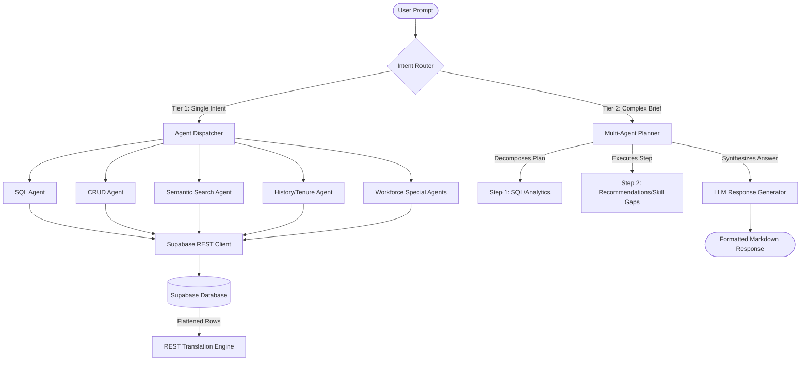

# 🤖 Enterprise HR AI Assistant v2.0

An intelligent, multi-agent HR management chatbot and executive dashboard built with Python, Streamlit, and Supabase. The assistant translates natural language requests into structured database lookups, vector-similarity searches, and multi-step workforce planning audits.

---

## 🏗️ System Architecture



---

## 🌟 Key Features

*   **Two-Tier Orchestration:** Simple queries utilize a fast-path single agent router, while complex multi-step instructions (e.g. *"build a fintech team and find skill gaps"*) trigger the multi-agent **Planner** to execute sequential plans.
*   **Vector Search with Local Keyword Fallback:** Semantic searches query vector embeddings via PGVector. If embeddings are missing or unseeded, the system automatically falls back to tokenized keyword matching across flattened database fields.
*   **Emulated REST SQL Engine:** Handles complex SQL `SELECT` queries with table joins, group-by aggregations, string filters (`ILIKE`), and numeric comparisons (`>`, `<`, `>=`, `<=`) directly in-memory when database RPC permissions are unavailable.
*   **Career Timeline & Aggregation:** Calculates precise tenure, promotion frequency, average promotion intervals, and career stall durations (flagging employees with 4+ years of no advancement) using active join profiles.
*   **Automated PDF Report Generator:** Packages real-time workforce trends and employee lists into custom PDF reports.
*   **Interactive Diagnostics Suite:** Built-in dashboard (`pages/7_diagnostics.py`) to run and evaluate the 25-question test harness with safety rate-limiting delays.

---

## 🛠️ Tech Stack

*   **Frontend UI:** Streamlit (Premium customized dark-mode surfaces and HSL-tailored colors).
*   **Core Backend:** Python 3.11.
*   **Database/Storage:** Supabase PostgreSQL (PostgREST API + PGVector).
*   **LLM Provider:** Groq (Llama-based translation models).

---

## 🚀 Setup & Installation

### 1. Prerequisites
Ensure you have Python 3.11+ installed.

### 2. Clone and Setup Environment
Clone the repository to your local directory:
```bash
git clone https://github.com/JEEVANPRANAVRAVIKUMAR/AI_HR_chatbot-new-.git
cd AI_HR_chatbot-new-
```

Create a `.env` file in the root directory and specify your API credentials:
```env
APP_NAME="Enterprise HR AI Assistant"
APP_VERSION="2.0.0"
GROQ_API_KEY="your_groq_api_key"
GROQ_MODEL="openai/gpt-oss-120b"
EMBEDDING_MODEL="sentence-transformers/all-MiniLM-L6-v2"
SUPABASE_URL="https://your_project.supabase.co"
SUPABASE_KEY="your_supabase_anon_or_service_key"
```

### 3. Install Dependencies
Create a virtual environment and install the required modules:
```powershell
python -m venv .venv
# On Windows Powershell:
.venv\Scripts\Activate.ps1
# On Linux/macOS:
source .venv/bin/activate

pip install -r requirements.txt
```

### 4. Supabase Database Migration
Run this script in the **SQL Editor** of your Supabase dashboard to create the audit trail tables and constraints:
```sql
CREATE TABLE IF NOT EXISTS employee_history (
    id              BIGINT GENERATED ALWAYS AS IDENTITY PRIMARY KEY,
    employee_id     BIGINT,
    employee_no     TEXT   NOT NULL,
    event_type      TEXT   NOT NULL,
    from_value      TEXT,
    to_value        TEXT,
    field           TEXT,
    note            TEXT,
    occurred_at     TIMESTAMPTZ NOT NULL DEFAULT NOW(),

    CONSTRAINT employee_history_event_type_chk CHECK (
        event_type IN (
            'hired', 'promoted', 'transferred', 'department_changed',
            'position_changed', 'status_changed', 'salary_changed',
            'created', 'updated', 'reactivated', 'deactivated', 'deleted'
        )
    )
);

CREATE INDEX IF NOT EXISTS idx_employee_history_employee
    ON employee_history (employee_no, occurred_at DESC);

ALTER TABLE employee_history
    DROP CONSTRAINT IF EXISTS fk_employee_history_employee;

ALTER TABLE employee_history
    ADD CONSTRAINT fk_employee_history_employee
    FOREIGN KEY (employee_no)
    REFERENCES employees (employee_no)
    ON DELETE CASCADE;

ALTER TABLE employee_history ENABLE ROW LEVEL SECURITY;

CREATE POLICY employee_history_read_all ON employee_history FOR SELECT USING (true);
CREATE POLICY employee_history_write_all ON employee_history FOR ALL USING (true) WITH CHECK (true);

ALTER TABLE employees ADD COLUMN IF NOT EXISTS updated_at timestamptz DEFAULT now();
UPDATE employees SET updated_at = created_at WHERE updated_at IS NULL;
```

---

## 🖥️ Running the Application

To start the Streamlit server, execute the appropriate script based on your operating system:

*   **Windows (PowerShell):**
    ```powershell
    .\run.ps1
    ```
*   **Windows (Command Prompt):**
    ```cmd
    run.bat
    ```
*   **Linux/macOS:**
    ```bash
    chmod +x run.sh
    ./run.sh
    ```

---

## 🔍 Evaluating the System

Open the **Diagnostics** panel from the sidebar menu to run the 25-question verification suite. The dashboard will display real-time execution speeds, classification metrics, and detailed prompt outputs.
