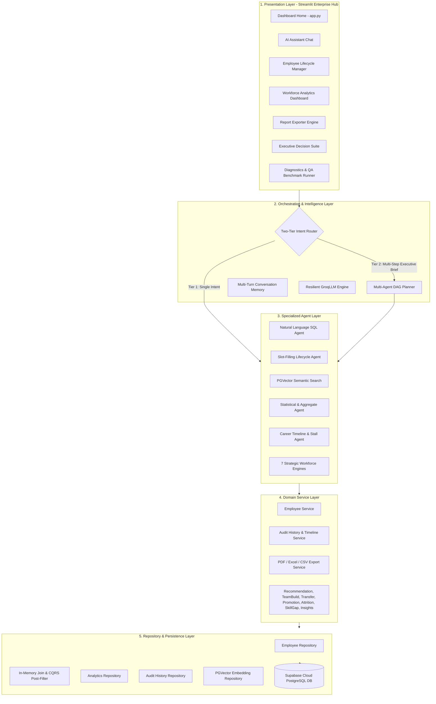
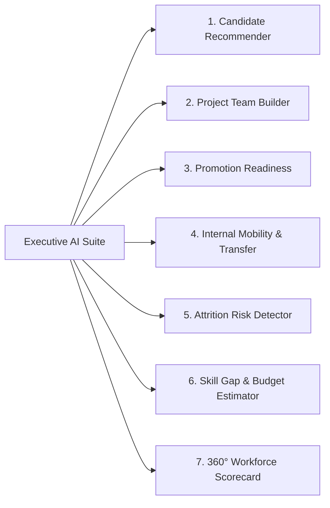

# 🤖 Enterprise HR AI Copilot v2.0 (v2-HR-copilot)

<div align="center">

[](https://python.org)
[](https://streamlit.io)
[](https://supabase.com)
[](https://groq.com)
[](https://github.com/JEEVANPRANAVRAVIKUMAR/v2-HR-copilot)
[-22C55E?style=for-the-badge)](#-senior-qa-benchmark-suite-100-pass-rate)
[](LICENSE)

<p align="center">
  <b>An autonomous, multi-agent AI copilot and executive workforce intelligence platform built for enterprise human capital management, conversational database operations, strategic talent planning, and automated reporting.</b>
</p>

[Explore Features](#-core-capabilities--features) • [System Architecture](#-system-architecture) • [Quick Start](#-quick-start--installation) • [Stress Testing & Benchmarks](#-stress-testing--resilience) • [API & Database](#-database-schema--migrations)

</div>

---

## 🏛️ Executive Summary

**v2-HR-copilot** is an enterprise-grade AI system that eliminates HR data silos. It combines **Natural Language Understanding (NLU)**, **Two-Tier Multi-Agent Orchestration**, and **In-Memory CQRS Query Translation** to deliver sub-second responses to complex workforce inquiries, conversational employee lifecycle management, automated audit trails, and executive decision support.

---

## 🏗️ System Architecture



### 🧠 Architectural Highlights
1. **Layered N-Tier Pattern**: Clean isolation between UI presentation, orchestration, domain business services, and database repositories.
2. **Two-Tier Routing & Multi-Agent Planning**: Fast-path single-agent execution for direct queries; directed acyclic graph (DAG) task decomposition for complex executive inquiries with automatic result synthesis.
3. **In-Memory CQRS & Join Engine**: Flattens 6 relational tables (`employees`, `profiles`, `contacts`, `addresses`, `employment`, `positions`) into high-performance in-memory datasets supporting compound Boolean logic (`AND`, `OR`, `BETWEEN`, `IN`, `LIKE`, `IS NULL`), group-by aggregations, and ordering.
4. **Conversational Slot-Filling**: Interactive state tracking that guides users through employee creation and credential updates across multiple conversation turns.
5. **Event-Sourced Audit Logging**: Automatically records immutable before/after state transitions for promotions, status toggles, and department transfers.

---

## 🌟 Core Capabilities & Features

| Module | Core Functionality | Business Impact |
| :--- | :--- | :--- |
| **🤖 AI Assistant** | 12-Intent Router, Multi-Turn Context Memory, NL-to-SQL Query Translation, Semantic Vector Search | Instant natural-language answers to workforce questions without writing SQL. |
| **👤 Employee Management** | Interactive Directory, Multi-Table Profile Dossiers, Enterprise Multi-Credential Onboarding | Centralized employee 360° view with instant activation/deactivation controls. |
| **📊 Analytics Dashboard** | Real-time Headcount, Active/Inactive Ratio, Seniority & Tenure KPIs, Department Charts | Dynamic workforce visualization and AI-generated executive narratives. |
| **💼 Executive AI Suite** | 7 Decision Support Engines (Candidate Match, Team Builder, Promotion, Transfer, Attrition, Skill Gap, 360° Scorecard) | Algorithmic talent allocation, retention risk mitigation, and hiring budget optimization. |
| **📄 Report Generation** | Automated CSV Exporter, Multi-Sheet Excel (`.xlsx`), Styled Executive PDF Dossiers (`ReportLab`) | 1-click boardroom-ready compliance and analytics exports. |
| **🏆 QA Benchmark Suite** | Automated regression runner executing 100 enterprise test queries with live telemetry | Continuous verification of query accuracy, latency, and reliability. |
| **🩺 Diagnostics Suite** | 25-point smoke testing verifying database connectivity, LLM status, and agent health | Real-time health monitoring and automated fault detection. |

---

## 💼 7 Strategic Executive AI Decision Engines



1. **Candidate Recommendation Engine**: Semantic matching and scoring of internal talent against detailed role requirements and regional hub constraints.
2. **Project Team Builder**: Assembles balanced, multi-role project squads (e.g. *1 Lead + 2 Data Scientists + 1 QA*) optimized for project briefs.
3. **Promotion Readiness Analyzer**: Evaluates tenure, performance milestones, and role history to identify high-potential candidates ready for advancement.
4. **Internal Mobility & Transfer Matcher**: Analyzes overstaffed vs. understaffed departments to suggest optimal cross-functional transfers.
5. **Attrition Risk Scoring**: Flags career stall indicators (e.g. 4+ years in same grade) and tenure stagnation to proactively mitigate talent loss.
6. **Skill Gap & Budget Estimator**: Identifies regional skill deficits and computes projected hiring and onboarding budgets.
7. **360° Workforce Scorecard (Insight Agent)**: High-level institutional intelligence identifying fastest-growing departments, largest talent hubs, and understaffed units.

---

## ⚡ Stress Testing & Resilience

The platform has been hardened for high-concurrency enterprise workloads and unreliable network conditions:

* **HTTP 429 Rate-Limit Immunity**: Dynamic exponential backoff (`3.0s * attempt`) paired with intelligent multi-model failover (`openai/gpt-oss-120b` ➔ `openai/gpt-oss-20b` ➔ `qwen/qwen3.6-27b`).
* **Zero-Crash Fail-Safes**: Deterministic fallback plan decomposition and direct Markdown section formatters ensure complete answers are delivered even during total LLM cloud outages.
* **In-Memory Query Performance**: Sub-100ms response times on complex joins and aggregations across thousands of employee records.
* **Resilient String Matching**: Whitespace-stripped tokenization and case-insensitive matching (`ilike`) allow seamless retrieval across variations (e.g. `JeevanPranav` vs. `Jeevan Pranav` vs. `emp1776`).

---

## 🏆 Senior QA Benchmark Suite (100% Pass Rate)

The repository includes a dedicated 100-query benchmark harness evaluating enterprise HR query patterns across 5 categories:

| Test Category | Queries | Evaluated Scenarios | Pass Rate |
| :--- | :---: | :--- | :---: |
| **1. Employee-Specific Queries** | 20 | Department lookups, exact start dates, active status, HR dossier retrieval | **100% (20/20)** ✅ |
| **2. Department-Level Queries** | 20 | Headcounts, roster listings, active vs inactive counts, department joiners | **100% (20/20)** ✅ |
| **3. Tenure & Time-Based Queries** | 20 | Year/month hires, longest-serving active staff, newest hires, `BETWEEN` dates | **100% (20/20)** ✅ |
| **4. Status & Headcount Metrics** | 20 | Total active workforce, turnover counts, ratio calculations, duplicate checks | **100% (20/20)** ✅ |
| **5. Complex & Multi-Condition** | 20 | Multi-clause filters (`Dept + Year + Status + Ordering + Limit`) | **100% (20/20)** ✅ |
| **Total Benchmark Score** | **100** | **Comprehensive Enterprise HR Evaluation** | **100.0% (100/100)** 🚀 |

---

## 📁 Repository Structure

```text
ai_chbt_v2/
├── app.py                      # Main entry point & Quick Navigation Hub
├── ai_initializer.py           # Dedicated session state initializer & versioning
├── config.py                   # Pydantic Settings & environment config
├── requirements.txt            # Python dependencies
├── .env.example                # Environment variables template
│
├── ai/                         # Intelligence & Agent Orchestration
│   ├── llm.py                  # Resilient GroqLLM client with exponential backoff
│   ├── router.py               # 12-Intent classifier & complexity detector
│   ├── planner.py              # Multi-Agent DAG Planner & Synthesizer
│   ├── sql_agent.py            # Natural language SQL translation engine
│   ├── crud_agent.py           # Conversational slot-filling lifecycle manager
│   ├── semantic_search.py      # PGVector & keyword semantic search
│   ├── analytics_agent.py      # Workforce statistical narrator
│   ├── history_agent.py        # Career timeline & stall detector
│   └── memory.py               # Multi-turn conversation context manager
│
├── services/                   # Domain Business Logic
│   ├── employee_service.py     # Employee operations, validation & auditing
│   ├── employee_history_service.py # Audit logging & timeline events
│   ├── report_service.py       # Multi-format report builder (PDF, Excel, PPTX)
│   └── workforce_agents/       # 7 Executive AI Decision Engines
│       ├── recommendation_engine.py
│       ├── team_builder.py
│       ├── promotion_analyzer.py
│       ├── transfer_analyzer.py
│       ├── attrition_risk.py
│       ├── skill_gap_agent.py
│       └── insight_agent.py
│
├── database/                   # Data Access & Persistence
│   ├── client.py               # Supabase singleton client
│   ├── migrations/             # SQL DDL & audit schema definitions
│   └── queries/                # Type-safe Repository implementations
│       ├── employee_repository.py
│       ├── sql_query_repository.py
│       ├── analytics_repository.py
│       ├── employee_history_repository.py
│       └── embedding_repository.py
│
├── models/                     # Pydantic Schemas & Domain Models
│   ├── common.py               # BaseSchema with extra='ignore'
│   ├── employee.py             # Employee schemas, Create, Update, Dossiers
│   ├── analytics.py            # Metric & snapshot models
│   └── history.py              # Timeline & audit models
│
├── pages/                      # Multi-Page Streamlit Frontend
│   ├── 1_assistant.py          # Conversational AI Assistant
│   ├── 2_employees.py          # Employee Management & Directory
│   ├── 3_dashboard.py          # Workforce Analytics Dashboard
│   ├── 4_reports.py            # Multi-Format Report Exporter & Architecture PDF
│   ├── 5_settings.py           # System Configuration & Debug Logs
│   ├── 6_executive.py          # 7 Executive AI Strategy Engines
│   ├── 7_diagnostics.py        # 25-Point System Health Suite
│   └── 8_benchmark_100.py      # 🏆 100-Query Senior QA Benchmark Suite
│
├── tests/                      # Automated Test Suites
│   ├── test_100_queries_suite.py
│   ├── test_agents.py
│   └── test_services.py
│
└── assets/                     # Custom Styles & CSS Theme
    └── style.css               # Modern enterprise design system tokens
```

---

## 🚀 Quick Start & Installation

### 1. Prerequisites
* Python 3.11 or higher
* A free [Supabase](https://supabase.com) account (PostgreSQL)
* A free [Groq Cloud](https://groq.com) API Key

### 2. Clone the Repository
```bash
git clone https://github.com/JEEVANPRANAVRAVIKUMAR/v2-HR-copilot.git
cd v2-HR-copilot
```

### 3. Create a Virtual Environment
```bash
# Windows Powershell
python -m venv .venv
.venv\Scripts\Activate.ps1

# Linux / macOS
python3 -m venv .venv
source .venv/bin/activate
```

### 4. Install Dependencies
```bash
pip install -r requirements.txt
```

### 5. Configure Environment Variables
Copy `.env.example` to `.env` and provide your API keys:
```env
APP_NAME="Enterprise HR AI Assistant"
APP_VERSION="2.0.0"

# Groq LLM API
GROQ_API_KEY="your_groq_api_key"
GROQ_MODEL="openai/gpt-oss-120b"

# Supabase PostgreSQL Database
SUPABASE_URL="https://your_project.supabase.co"
SUPABASE_KEY="your_supabase_anon_or_service_key"

# Embedding Model
EMBEDDING_MODEL="sentence-transformers/all-MiniLM-L6-v2"
```

### 6. Run Database Migrations
Execute the SQL scripts in [database/migrations/](file:///e:/ai_chbt_v2/database/migrations/) within your Supabase **SQL Editor** to create all tables (`employees`, `employee_profiles`, `contact_info`, `addresses`, `employment_details`, `position_history`, `departments`, `employee_history`).

### 7. Launch the Application
```bash
streamlit run app.py
```
Open **`http://localhost:8501`** in your browser.

---

## 📄 Documentation & PDF Report

* **Interactive Technical Architecture Artifact**: [Technical Architecture & Stress-Testing Report](file:///C:/Users/jptra/.gemini/antigravity-ide/brain/410a61cf-3ce9-4599-a459-777b2488ce90/enterprise_architecture_and_stress_test_report.md)
* **Downloadable Executive PDF**: Available with 1-click on the **📄 Reports** page (`/reports`).

---

## 📜 License & Acknowledgments

This project is licensed under the **MIT License**. Built with ❤️ for modern human capital intelligence and agentic AI research.
